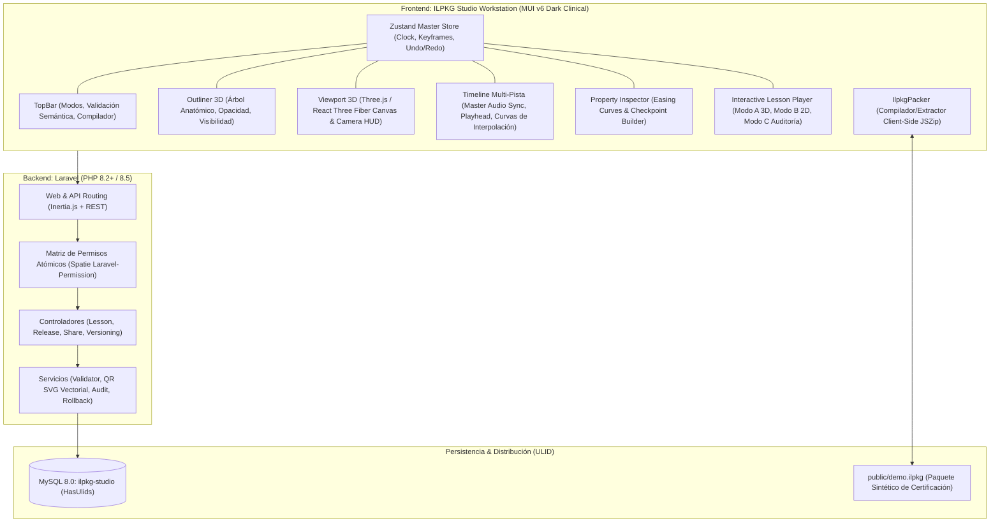

# ILPKG Studio

> **Digital Audio & 3D Workstation para Autoría y Reproducción de Lecciones Médicas Interactivas**

[](https://php.net)
[](https://laravel.com)
[](https://react.dev)
[](https://www.typescriptlang.org)
[](https://mui.com)
[](https://threejs.org)
[-4479A1?logo=mysql&logoColor=white)](https://www.mysql.com)
[](tests)
[-red)](docs/politica_de_componentes.md)

---

## 📋 Descripción General

**ILPKG Studio** es una estación de trabajo digital médica y pedagógica inspirada en los estándares de estaciones de audio digital (DAW) y suites 3D especializadas. Permite a anatomistas, docentes médicos y especialistas clínicos diseñar, editar, sincronizar, evaluar y empaquetar lecciones interactivas tridimensionales de alta fidelidad en el formato abierto estandarizado `.ilpkg` (*Interactive Lesson Package*).

El sistema desacopla la autoría cinemática de la renderización final, permitiendo sincronizar locución médica profesional con movimientos de cámara en 3D, modulación de opacidad/visibilidad de estructuras anatómicas en tiempo real, esquemas complementarios 2D y paradas evaluativas obligatorias (**Checkpoints**) con algoritmos de retroceso inteligente (*Pedagogical Rewind*).

---

## 🏛️ Arquitectura del Sistema



---

## 💻 Características Principales

### 1. Cuadrantes del Workstation Studio (`/studio`)
* **Cuadrante A — Barra Superior (TopBar):** Gestión de metadatos, chip de validación semántica reactiva en tiempo real (Válido, Advertencias, Errores), selector de modo (*Estudio* vs. *Simulación de Alumno*), carga de lección de demostración y botón de compilación/descarga `.ilpkg`.
* **Cuadrante B — Outliner Anatómico 3D:** Árbol jerárquico de mallas y estructuras anatómicas con filtro instantáneo, interruptores de visibilidad por elemento, controles deslizantes de opacidad en tiempo real (`0.0` a `1.0`) y atajos para grabación de fotogramas clave (`Ctrl + M`).
* **Cuadrante C — Viewport 3D Cinematográfico:** Canvas acelerado por hardware con Three.js y React Three Fiber. Incluye controles orbitales, renderizado de modelos GLTF/GLB reales, HUD cinemático con puntos de vista anatómicos estándar (Anterior, Posterior, Lateral, Superior) y captura instantánea de pose de cámara (`Ctrl + K`).
* **Cuadrante D — Inspector de Propiedades:** Editor contextual adaptativo según el elemento seleccionado en la línea de tiempo. Permite parametrizar curvas de aceleración (*Linear, EaseInOutCubic, Spline, Teleport*) y diseñar reactivos formativos de opción múltiple.
* **Cuadrante E — Línea de Tiempo Multi-Pista:** Regla milimétrica con playhead de arrastre fluido sincronizado al reloj maestro de audio y 5 pistas especializadas:
  1. *Audio Master:* Forma de onda y sincronización temporal exacta.
  2. *Cámara:* Fotogramas clave de transición y encuadre.
  3. *Anatomía / Mallas:* Eventos de aparición, desvanecimiento y resaltado.
  4. *Diapositivas:* Despliegue de esquemas 2D y cortes histológicos/anatómicos.
  5. *Checkpoints:* Marcadores con conector curvo visual hacia su segundo de rebobinado pedagógico (`rewindTimestamp`).

### 2. Reproductor Adaptativo de Lecciones (`/lessons/{slug}/player`)
* **Modo A (3D Interactivo Completo):** Viewport WebGL interactivo guiado por la cámara del autor pero con libertad de inspección orbital.
* **Modo B (Fallback 2D):** Despliegue alternativo para dispositivos móviles o estaciones sin GPU dedicada.
* **Modo C (Auditoría Estática Forense):** Vista desglosada con expediente de respuestas del alumno cuando los archivos binarios han sido purgados del servidor.
* **Scrubbing Lock & Rebote Pedagógico:** Bloqueo de avance en la barra de tiempo ante un checkpoint. Si el alumno falla el reactivo, el reproductor rebobina forzadamente al punto de explicación conceptual clave (`rewindTimestamp < timestamp`).

### 3. Compilador de Paquetes Client-Side (`IlpkgPacker`)
* Compresión y descompresión de archivos `.ilpkg` (ZIP bajo estándar Deflate) 100% en el navegador utilizando `JSZip` y `file-saver`.
* Soporte para apertura de paquetes mediante **Drag & Drop** directo en el navegador.

### 4. Matriz de Permisos Atómicos Puros
* Autorización gestionada vía Spatie Laravel-Permission basada estrictamente en **14 capacidades atómicas independientes** consultadas mediante `$user->can(...)` o `@can(...)`:
  * `lessons.create`, `lessons.view`, `lessons.edit.metadata`, `lessons.edit.timeline`, `lessons.delete`
  * `releases.publish`, `releases.rollback`, `releases.download`
  * `qr.generate`, `qr.revoke`
  * `attempts.view.own`, `attempts.view.all`, `attempts.export`
  * `system.audit.logs`
* Cero comprobaciones basadas en nombres de rol en la lógica de negocio.

### 5. Identificadores ULID Universales
* 100% de los modelos Eloquent y tablas de persistencia utilizan **ULID** (`HasUlids`), eliminando la exposición de identificadores autoincrementales, optimizando la ordenación cronológica y previniendo la fragmentación de índices B-Tree en MySQL.

---

## 📦 Estructura del Archivo `.ilpkg`

Un paquete `.ilpkg` es un archivo ZIP comprimido con la siguiente estructura interna:

```text
leccion_anatomia.ilpkg
├── manifest.json         # Metadatos pedagógicos, duración, versión y diccionario de mallas
├── lesson.json           # Línea de tiempo (keyframes de cámara, mallas, slides y checkpoints)
├── thumb.webp            # Miniatura de portada de la lección
├── models/
│   └── anatomy.glb       # Modelo 3D en formato binario GLTF 2.0
├── audio/
│   └── narration.wav     # Pista de audio máster (PCM / MP3 / OGG)
└── slides/
    ├── slide_01.svg      # Diagramas y esquemas anatómicos 2D
    └── slide_02.webp
```

---

## 🛠️ Tecnologías Empleadas

### Backend
* **Lenguaje:** PHP 8.2+ / PHP 8.5
* **Framework:** Laravel 12 / 13
* **Persistencia:** MySQL 8.0 con clave primaria ULID
* **Seguridad:** Spatie Laravel-Permission (Permisos atómicos puros)
* **Generador QR:** `bacon/bacon-qr-code` con backend vectorial puro SVG (`SvgImageBackEnd`)
* **Frontend Adapter:** Inertia.js React v2

### Frontend
* **Core:** React 19, TypeScript 5.8
* **Componentes UI:** Material UI v6 (MUI) + Emotion (*Diseño Dark Clinical*)
* **Restricción de Estilos:** **Cero Tailwind CSS** (100% verificado mediante auditorías automáticas)
* **3D & WebGL:** Three.js, React Three Fiber (`@react-three/fiber`), Drei (`@react-three/drei`)
* **Estado Global:** Zustand v5
* **Audio:** Wavesurfer.js v7
* **Empaquetado:** JSZip v3, FileSaver v2
* **Iconografía:** Lucide React & MUI Icons

---

## 🚀 Instalación y Puesta en Marcha

### Prerrequisitos
* PHP >= 8.2 (con extensiones `pdo_mysql`, `mbstring`, `zip`, `xml`, `ctype`)
* Composer >= 2.6
* Node.js >= 20.x y npm
* MySQL Server >= 8.0

### Pasos de Configuración

1. **Clonar el repositorio:**
   ```bash
   git clone https://github.com/antsanch/ilpkg-studio.git
   cd ilpkg-studio
   ```

2. **Configurar el entorno:**
   ```bash
   cp .env.example .env
   ```
   Ajuste las credenciales de base de datos en su archivo `.env`:
   ```env
   DB_CONNECTION=mysql
   DB_HOST=127.0.0.1
   DB_PORT=3306
   DB_DATABASE=ilpkg-studio
   DB_USERNAME=root
   DB_PASSWORD=su_password
   ```

3. **Instalar dependencias de backend:**
   ```bash
   composer install
   ```

4. **Generar la clave de la aplicación:**
   ```bash
   php artisan key:generate
   ```

5. **Ejecutar migraciones y semillero (Seeders):**
   ```bash
   php artisan migrate:fresh --seed
   ```
   *Esto generará automáticamente la estructura ULID, los permisos atómicos y el paquete de demostración `demo.ilpkg`.*

6. **Instalar dependencias de frontend y compilar:**
   ```bash
   npm install
   npm run build
   ```

---

## 🏃 Ejecución del Entorno de Desarrollo

Puede iniciar todos los servicios concurrentemente o de forma independiente:

### Opción A: Inicio Concurrente
```bash
composer run dev
```

### Opción B: Terminales Separadas

* **Terminal 1 — Backend (Laravel):**
  ```bash
  php artisan serve --port=8001
  ```

* **Terminal 2 — Frontend (Vite HMR):**
  ```bash
  npm run dev
  ```

* **Terminal 3 — Colas y Registro (Opcional):**
  ```bash
  php artisan queue:listen
  ```

---

## 🔑 Cuentas y Accesos de Prueba

El semillero inicializa los siguientes perfiles (todos con contraseña: `password`):

| Perfil / Rol | Correo Electrónico | Capacidades Principales |
| :--- | :--- | :--- |
| **Autor Clínico (Creator)** | `creator@ilpkg.studio` | Crear, editar keyframes, publicar releases y exportar `.ilpkg` |
| **Estudiante (Student)** | `student@ilpkg.studio` | Acceso a player, responder checkpoints y ver historial propio |
| **Revisor Médico (Reviewer)** | `reviewer@ilpkg.studio` | Auditoría de intentos, visualización forense y control de calidad |

### Enlaces Principales:
* **Workstation Studio (Modo Autoría):** [http://127.0.0.1:8001/studio](http://127.0.0.1:8001/studio)
* **Reproductor de Alumno:** [http://127.0.0.1:8001/lessons/neuroanatomia-maxilar/player](http://127.0.0.1:8001/lessons/neuroanatomia-maxilar/player)
* **Prueba de Aislamiento de Permisos:**
  * `http://127.0.0.1:8001/studio?as=creator` *(200 OK — Autorizado)*
  * `http://127.0.0.1:8001/studio?as=student` *(403 Forbidden — Bloqueado por Gate)*

---

## 🧪 Pruebas Automatizadas

El proyecto cuenta con suites de pruebas unitarias y de integración tanto en backend como en frontend:

### Pruebas de Backend (PHPUnit)
Evalúa validaciones de esquemas JSON, reglas pedagógicas, ciclo de vida de lecciones, matriz atómica de permisos, reversión histórica transaccional y extracción bit a bit de paquetes `.ilpkg`:
```bash
./vendor/bin/phpunit
# o vía composer:
composer test
```

### Pruebas de Frontend (Vitest)
Evalúa el store reactivo Zustand, interpolación de poses de cámara y ejecuta la auditoría **React Doctor** que certifica la ausencia de utilidades o imports de Tailwind CSS:
```bash
npm test
# o en modo interactivo:
npx vitest
```

---

## 📁 Estructura del Proyecto

```text
ilpkg-studio/
├── app/
│   ├── Http/Controllers/       # Controladores (Studio, Lesson, Release, Share)
│   ├── Models/                 # Modelos Eloquent con HasUlids y SoftDeletes
│   └── Services/               # Servicios (Validator, QrSharing, Audit, Versioning)
├── config/                     # Configuraciones del framework y paquetes
├── database/
│   ├── migrations/             # Migraciones con esquemas ULID
│   └── seeders/                # Semilleros de permisos, usuarios y lección demo
├── docs/                       # Documentación técnica, manuales y especificaciones
│   ├── MANUAL_DE_USUARIO_ILPKG_STUDIO.md
│   ├── REPORTE_FINAL_IMPLEMENTACION.md
│   ├── Manifest_specification.md
│   ├── politica_de_componentes.md
│   └── ...
├── public/
│   └── demo.ilpkg              # Paquete sintético de validación anatómica
├── resources/
│   ├── js/
│   │   ├── Components/         # Cuadrantes modulares (TopBar, Viewport3D, Timeline...)
│   │   ├── Pages/              # Vistas principales Inertia (Studio, Player, Audit)
│   │   ├── Services/           # Compilador IlpkgPacker y utilidades cliente
│   │   ├── Store/              # Store global Zustand
│   │   └── Theme/              # Tema Dark Clinical de Material UI v6
│   └── views/
│       └── app.blade.php       # Plantilla base Inertia
├── routes/
│   └── web.php                 # Rutas de aplicación y endpoints REST
└── tests/
    ├── Feature/                # Pruebas de integración PHPUnit
    └── Vitest/                 # Pruebas reactivas y auditoría de estilos Vitest
```

---

## 📚 Documentación Adicional

Para más información y guías de desarrollo, consulte la carpeta [`docs/`](docs/):
* [Manual de Usuario de ILPKG Studio](docs/MANUAL_DE_USUARIO_ILPKG_STUDIO.md)
* [Reporte Final de Implementación](docs/REPORTE_FINAL_IMPLEMENTACION.md)
* [Especificación Técnica del Formato `.ilpkg`](docs/especificaci_n_t_cnica_formato_de_paquete_ilpkg_interactive_lesson_package.md)
* [Especificación de la Interfaz del Reproductor](docs/especificaci_n_e_interfaz_del_reproductor_de_alumnos_interactive_lesson_player.md)
* [Política de Componentes y Estilos](docs/politica_de_componentes.md)

---

## 📄 Licencia

Este proyecto está bajo la licencia [MIT](LICENSE).
