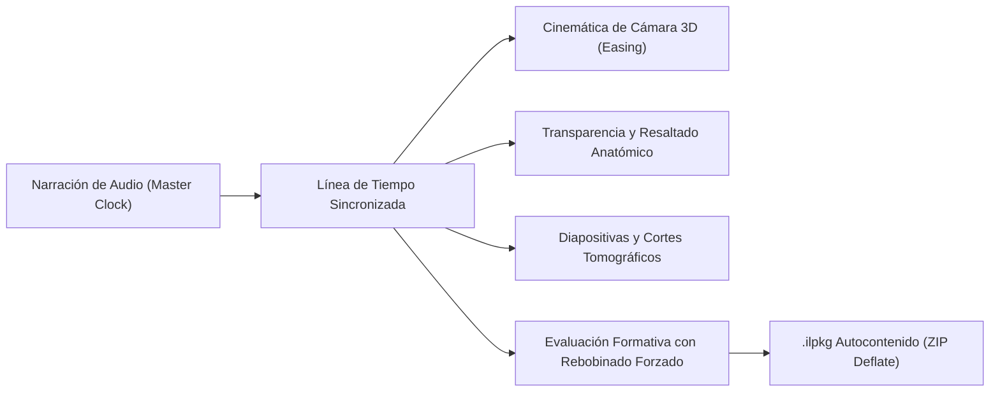
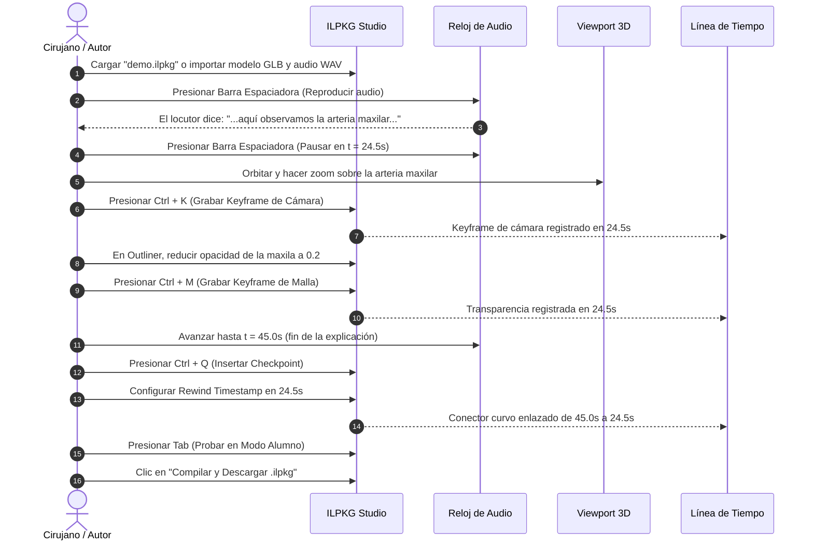

# MANUAL DE USUARIO: ILPKG STUDIO
**Estación de Trabajo Digital (DAW) de Audio y 3D para la Autoría de Lecciones Médicas Interactivas**

---

## 1. Introducción y Conceptos Fundamentales

**ILPKG Studio** es una estación de trabajo de grado médico y cinemático diseñada para autores, anatomistas, cirujanos y docentes. Su objetivo es crear lecciones interactivas tridimensionales sincronizadas con narración clínica de alta fidelidad dentro del formato abierto e inmutable **`.ilpkg`** (*Interactive Lesson Package*).



### Principios Clave:
* **Audio Master Clock:** La narración de voz actúa como el reloj maestro indiscutible de la lección; las animaciones de cámara, cambios de visibilidad de las estructuras anatómicas y los reactivos de examen están anclados a segundos específicos de dicho audio.
* **Paquete Autocontenido (`.ilpkg`):** Un archivo comprimido estándar (algoritmo Deflate) que incluye metadatos (`manifest.json`), eventos cinemáticos (`lesson.json`), modelo anatómico (`models/anatomy.glb`), audio (`audio/narration.wav`), esquemas (`slides/`) y portada (`thumb.webp`).
* **Pedagogía con Rebobinado Formativo:** Si un alumno reprueba un reactivo o control clínico, el sistema bloquea el avance hacia adelante y ejecuta un salto interactivo forzado hacia un segundo previo (`rewindTimestamp`) para reforzar el concepto anatómico antes de permitirle continuar.

---

## 2. Mapa Visual de la Interfaz (Los 5 Cuadrantes)

La interfaz adopta una disposición tipo **DAW profesional (Digital Audio Workstation)** de bajo estrés visual (*Dark Clinical Theme*):

```
+---------------------------------------------------------------------------------------------------+
|  [A] TOP BAR: Título de Lección | Chip de Validación | Modo (Edición / Player) | Abrir | Compilar |
+-----------------------+---------------------------------------------------+-----------------------+
|  [B] OUTLINER 3D      |  [C] VIEWPORT 3D (Three.js WebGL Canvas)           |  [D] PROPERTY         |
|  - Filtro semántico   |  - Navegación orbital médica                       |      INSPECTOR        |
|  - Árbol de mallas    |  - HUD de Enfoque Rápido (Ant, Post, Lat, Sup)    |  - Curvas de Cámara   |
|  - Visibilidad (Ojo)  |  - Captura de Pose de Cámara (Ctrl+K)             |  - Easing selector    |
|  - Opacidad en vivo   |                                                   |  - Editor Checkpoints |
|  - Botón Keyframe (M) |                                                   |  - Rewind Timestamp   |
+-----------------------+---------------------------------------------------+-----------------------+
|  [E] TIMELINE PANEL: Master Audio Track | Cámara | Mallas | Diapositivas | Checkpoints con Curvas |
|  Transporte: [ ⏮ Rebobinar 0s ]  [ ⏪ -1s ]  [ ▶ Play / ⏸ Pause ]  [ ⏩ +1s ]   Playhead: 00:14.200 |
+---------------------------------------------------------------------------------------------------+
```

---

## 3. Guía Detallada de Cuadrantes

### 🔹 Cuadrante A: Barra Superior de Control Maestro (`TopBar`)
1. **Título del Proyecto:** Campo de texto editable en vivo. Al modificarlo, se sincroniza inmediatamente con el manifiesto pedagógico.
2. **Chip de Integridad Semántica:**
   * 🟢 **Verde ("Válido"):** El manifiesto cumple con todas las reglas pedagógicas y referenciales.
   * 🟡 **Amarillo ("Advertencias"):** Existen sugerencias no críticas (e.g. descripciones breves).
   * 🔴 **Rojo ("Errores"):** Existen conflictos que impiden publicar (mallas no declaradas, `rewindTimestamp >= timestamp`, o falta de opciones correctas en checkpoints).
3. **Selector de Modos:**
   * **Modo Edición:** Habilita todas las herramientas de autoría, modificación de curvas, keyframing y manipulación de mallas.
   * **Modo Simulación Alumno:** Convierte la interfaz al reproductor interactivo con controles de play/pause, detención automática en checkpoints y bloqueo de scrubbing.
4. **Acciones de Paquete:**
   * **Cargar Demo:** Descarga e inicializa al instante el paquete sintético de demostración (`demo.ilpkg`) con modelo GLB, audio y checkpoints preconfigurados.
   * **Abrir .ilpkg:** Permite seleccionar cualquier archivo `.ilpkg` desde el disco local o arrastrarlo sobre la ventana.
   * **Compilar y Descargar:** Ensambla en memoria el paquete `.ilpkg` (ZIP Deflate) y descarga el archivo listo para distribución.

---

### 🔹 Cuadrante B: Árbol Anatómico (`Outliner 3D`)
Ubicado a la izquierda. Permite administrar de forma granular cada elemento del modelo tridimensional:
1. **Búsqueda Semántica:** Escribe el nombre en latín o español de cualquier estructura (ej. *maxilla*, *nervus*, *arteria*) para filtrar la lista en tiempo real.
2. **Conmutador de Visibilidad:** Haz clic en el icono del **ojo** para ocultar o mostrar instantáneamente cualquier elemento anatómico.
3. **Slider de Opacidad:** Control deslizante de `0.0` (invisible) a `1.0` (completamente sólido). Al mover el slider, los materiales Three.js con `alphaMode: BLEND` se transparentan en tiempo real en el Viewport 3D.
4. **Grabar Keyframe (`Ctrl + M`):** Graba la configuración actual de visibilidad y opacidad de la malla seleccionada en el segundo exacto donde se encuentre el cabezal de reproducción (*Playhead*).

---

### 🔹 Cuadrante C: Lienzo de Navegación 3D (`Viewport 3D`)
El centro del estudio es un lienzo WebGL acelerado por GPU:
1. **Controles de Navegación:**
   * **Orbitar / Rotar:** Clic izquierdo sostenido y arrastrar.
   * **Desplazar (Pan):** Clic derecho sostenido y arrastrar (o rueda del ratón sostenida).
   * **Zoom:** Deslizar la rueda del ratón hacia adelante o hacia atrás.
2. **HUD de Vistas Anatómicas Rápidas:**
   * **Anterior:** Encuadra el modelo frontalmente.
   * **Posterior:** Encuadra el modelo por la cara dorsal.
   * **Lateral:** Encuadra la vista lateral derecha/izquierda.
   * **Superior:** Encuadra el plano cenital / superior.
3. **Captura de Pose de Cámara (`Ctrl + K`):** Al mover libremente la vista orbital hasta el ángulo anatómico deseado, presiona **`Ctrl + K`** (o el botón *Capturar Pose* del HUD) para congelar la posición XYZ y el punto de enfoque en la línea de tiempo en el segundo actual.

---

### 🔹 Cuadrante D: Inspector de Parámetros (`Property Inspector`)
Ubicado a la derecha. Este panel es reactivo y adapta su contenido según el elemento que selecciones en la línea de tiempo:

#### 1. Cuando seleccionas un Keyframe de Cámara:
* **Coordenadas de Cámara:** Valores numéricos de posición `[X, Y, Z]`.
* **Punto de Enfoque (Target):** Coordenadas `[X, Y, Z]` hacia donde mira la cámara.
* **Duración:** Tiempo en segundos que tardará la transición desde el estado anterior.
* **Curva de Interpolación (*Easing*):**
  * `easeInOutCubic`: Aceleración y desaceleración suaves (ideal para transiciones cinemáticas médicas).
  * `linear`: Movimiento a velocidad constante.
  * `spline`: Trayectoria suave no lineal para rodear estructuras óseas.
  * `teleport`: Salto instantáneo de corte directo (sin animación de desplazamiento).

#### 2. Cuando seleccionas un Rombo de Checkpoint Evaluativo:
* **Título y Enunciado Clínico:** Pregunta formulada al alumno.
* **Timestamp de Activación:** Segundo del audio donde la lección se pausará obligatoriamente.
* **Timestamp de Rebobinado (`rewindTimestamp`):** Segundo del audio al que regresará el alumno si responde incorrectamente. Incluye el botón **"Fijar Playhead Actual"** para transferir la posición del cabezal con un solo clic.
* **Opciones de Respuesta:** Lista de opciones con conmutador de respuesta correcta y campo de retroalimentación formativa personalizada.

---

### 🔹 Cuadrante E: Línea de Tiempo Multi-Pista (`Timeline Panel`)
Ubicada en la base de la pantalla, permite controlar milimétricamente el desarrollo temporal:
1. **Playhead (Cabezal Rojo):** Muestra el segundo actual con precisión milimétrica (ej. `00:14.200`). Puedes arrastrarlo libremente para desplazarte por la lección.
2. **Pista de Audio Master:** Representa la forma de onda del archivo `.wav`. Si el audio está reproduciéndose, las ondas se sincronizan con la voz del locutor.
3. **Pista de Cámara:** Bloques rectangulares que indican las transiciones de encuadre. Al hacer clic sobre un bloque, se selecciona y resalta en el inspector.
4. **Pista de Anatomía (Mallas):** Muestra keyframes de transparencia y resaltado anatómico.
5. **Pista de Diapositivas:** Momentos de despliegue de esquemas 2D complementarios.
6. **Pista de Checkpoints:** Marcadores en forma de rombo. Cada rombo está conectado mediante una **línea curva visual SVG** que desciende hacia su punto de rebobinado correspondiente (`rewindTimestamp`), facilitando la revisión pedagógica.

---

## 4. Flujo de Trabajo Paso a Paso (Tutorial de Autoría)

### Objetivo: Crear una lección sobre la Fosa Pterigopalatina



1. **Paso 1 - Carga de Activos:** Presiona el botón **"Cargar Demo"** en la barra superior para abrir el paquete base con las 5 estructuras anatómicas y narración sincronizada.
2. **Paso 2 - Escucha y Sincronización:** Presiona la `Barra Espaciadora` para reproducir el audio. Observa cómo el playhead se desplaza sobre la forma de onda. Detén la reproducción (`Espacio`) en el segundo donde desees realizar un cambio de encuadre.
3. **Paso 3 - Captura de Cámara:** En el Viewport 3D, arrastra con el ratón hasta enfocar con claridad la estructura descrita por el audio. Presiona **`Ctrl + K`**. Aparecerá un bloque azul en la pista de cámara de la línea de tiempo.
4. **Paso 4 - Aislamiento Anatómico:** En el Outliner (izquierda), selecciona la estructura que oculta el campo quirúrgico (ej. `maxilla`) y desliza su opacidad a `0.2` para volverla semi-transparente. Presiona **`Ctrl + M`** para registrar el keyframe.
5. **Paso 5 - Creación del Reactivo Formativo:** Avanza el playhead al final del concepto anatómico (ej. segundo `45.0`) y presiona **`Ctrl + Q`**. Se abrirá el formulario en el Property Inspector:
   * Escribe la pregunta: *"¿Qué rama emerge por el foramen esfenopalatino?"*
   * Haz clic en **"Fijar Playhead Actual"** con el cabezal ubicado en el segundo de la explicación previa (ej. `24.5s`) para que quede como `rewindTimestamp`.
   * Agrega las opciones de respuesta y marca la correcta.
6. **Paso 6 - Verificación en Modo Alumno:** Presiona la tecla **`Tab`** para alternar a la vista del alumno. Reproduce la lección:
   * La lección se detendrá automáticamente en el segundo `45.0`.
   * Si respondes erróneamente y haces clic en *"Repasar Concepto"*, el reproductor rebobinará automáticamente a `24.5s` y reanudará la explicación.
7. **Paso 7 - Compilación:** Vuelve al modo edición (`Tab`), verifica que el chip de validación superior esté en **Verde**, y presiona **"Compilar y Descargar"** para obtener el archivo empaquetado final.

---

## 5. Tabla Maestra de Atajos de Teclado

Los atajos de teclado permiten una experiencia de edición ultra-rápida sin depender exclusivamente del ratón:

| Atajo de Teclado | Función y Alcance |
| :--- | :--- |
| **`Espacio`** | Alternar entre Reproducir y Pausar el Master Audio Clock |
| **`J`** | Retroceder 1 segundo en la línea de tiempo |
| **`L`** | Avanzar 1 segundo en la línea de tiempo |
| **`K`** | Pausar reproducción inmediatamente |
| **`Home`** *(Inicio)* | Regresar el cabezal de reproducción al segundo `00:00.000` |
| **`Ctrl + K`** | **Capturar Pose de Cámara actual** y grabar keyframe en el playhead |
| **`Ctrl + M`** | **Grabar Keyframe de Malla** (visibilidad y opacidad actuales) en el playhead |
| **`Ctrl + Q`** | **Insertar nuevo Checkpoint Evaluativo** en el playhead |
| **`Ctrl + Z`** | **Deshacer (Undo)** la última acción en la línea de tiempo |
| **`Ctrl + Y`** / **`Ctrl + Shift + Z`** | **Rehacer (Redo)** la acción deshecha |
| **`Tab`** | **Alternar Modos:** Conmuta entre Edición DAW y Simulación Alumno |

---

## 6. Modos del Reproductor de Alumno (`Interactive Lesson Player`)

El reproductor se adapta a las capacidades de hardware del alumno:

1. **Modo 3D Interactivo (GPU Acelerada):**
   * El alumno puede orbitar el modelo tridimensional libremente en cualquier momento.
   * Al ejecutarse un evento de cámara en la línea de tiempo, el viewport realiza una transición suave hacia el nuevo encuadre sin que el alumno pierda el contexto espacial.
2. **Modo Diapositivas 2D (Dispositivos Móviles / Baja Gama):**
   * Despliega las diapositivas tomográficas y vasculares en pantalla completa cuando el dispositivo no soporte WebGL 2.0.
3. **Modo Auditoría Médica Estática (`StaticAuditView`):**
   * Si la institución purga los archivos binarios pesados (modelos 3D y audio) tras el periodo lectivo, este modo genera una ficha curricular permanente con el historial de respuestas del alumno, el tiempo dedicado y la calificación obtenida.

---

## 7. Preguntas Frecuentes y Resolución de Problemas

> [!TIP]
> **¿Por qué el audio no se reproduce al hacer clic en Play por primera vez?**  
> Los navegadores modernos bloquean la reproducción de audio hasta que el usuario interactúa con la página. Haz clic en cualquier parte de la pantalla o presiona la `Barra Espaciadora` para autorizar el contexto de audio.

> [!NOTE]
> **¿Por qué el chip de validación muestra advertencias en rojo?**  
> Revisa el Property Inspector: las razones más comunes son que un checkpoint tiene un `rewindTimestamp` igual o mayor a su `timestamp`, o que se referenció una estructura que no existe en el glTF.

> [!IMPORTANT]
> **¿Cómo simular diferentes perfiles de usuario?**  
> En entorno local puedes agregar el parámetro `?as=` a la URL:
> * `http://127.0.0.1:8001/studio?as=creator` 👉 Acceso de edición completo (Docente Titular).
> * `http://127.0.0.1:8001/studio?as=student` 👉 Bloqueo 403 (Demuestra el aislamiento de seguridad para los estudiantes).

---

## 8. Glosario de Términos

* **DAW (Digital Audio Workstation):** Entorno de software optimizado para la manipulación sincronizada de pistas de audio y eventos temporales.
* **Easing (Interpolación):** Fórmula matemática que suaviza el movimiento de la cámara para simular aceleración física real en lugar de saltos rígidos.
* **Scrubbing Lock:** Bloqueo impuesto al estudiante en la barra de progreso que le impide avanzar más allá de un checkpoint hasta haber respondido el reactivo.
* **Rewind Timestamp:** Marca temporal de retorno formativo hacia la cual la lección rebobina forzadamente si el estudiante se equivoca en una pregunta clave.
