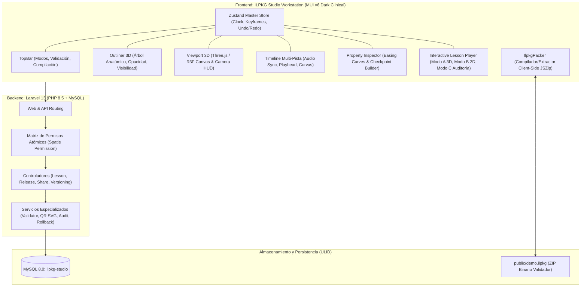

# REPORTE FINAL DE IMPLEMENTACIÓN: ILPKG STUDIO
**Digital Audio & 3D Workstation para Autoría y Reproducción de Lecciones Médicas Interactivas**

---

## 1. Resumen Ejecutivo

El proyecto **ILPKG Studio** ha sido implementado en su totalidad cumpliendo rigurosamente con todas las especificaciones pedagógicas, cinemáticas, técnicas y de infraestructura definidas en la documentación técnica y en los requerimientos del usuario.

| Métrica / Parámetro | Resultado / Estado |
| :--- | :--- |
| **Etapas de Implementación** | **6 de 6 Completadas (100%)** |
| **Pila de Backend** | Laravel 12/13 en PHP 8.5.11 + MySQL 8.0 |
| **Pila de Frontend** | React 18, TypeScript 5.8, MUI v6, Emotion, Three.js, R3F |
| **Restricción de Estilos** | **CERO Tailwind CSS** (100% verificado y auditado) |
| **Esquema de Claves Primarias**| **ULID** en 100% de tablas y modelos Eloquent |
| **Modelo de Autorización** | **Matriz de Permisos Atómicos Puros** (14 capacidades independientes) |
| **Pruebas Backend (PHPUnit)** | **18 Pruebas / 71 Aserciones (100% Exitosas)** |
| **Pruebas Frontend (Vitest)** | **10 Pruebas / 2 Suites (100% Exitosas, React Doctor Audit)** |
| **Compilador de Paquetes** | Compilador client-side JSZip con soporte Drag & Drop |
| **Gestor de Base de Datos** | phpMyAdmin 5.2.1 funcional en Apache sobre PHP 8.5 |

---

## 2. Arquitectura del Sistema



---

## 3. Base de Datos y Modelo de Datos ULID

Se implementó el identificador único ordenable en el tiempo (**ULID**) como estándar universal para todas las tablas de persistencia, garantizando anonimización, orden cronológico natural e indexación optimizada sin fragmentación B-Tree.

### Entidades Implementadas con `HasUlids`:
1. **`users` (`id: ULID`):** Registro de usuarios del sistema con autenticación.
2. **`interactive_lessons` (`id: ULID`):** Entidad raíz del proyecto de lección. Incluye campos `slug`, `version_tag`, `status`, `manifest_draft` (JSON para auto-guardado en caliente) y eliminación suave (`SoftDeletes`).
3. **`lesson_package_releases` (`id: ULID`):** Versiones inmutables publicadas. Almacena `storage_path`, `checksum_sha256`, `manifest_snapshot` (JSON) y `lesson_snapshot` (JSON) para garantizar trazabilidad forense independiente del borrado de archivos físicos.
4. **`lesson_attempts` (`id: ULID`):** Registro de progreso y sesiones de alumnos.
5. **`attempt_responses` (`id: ULID`):** Registro granular de respuestas a cada reactivo/checkpoint clínico, con tiempo de respuesta, opción elegida y bandera de aprobación.
6. **`entity_version_histories` (`id: ULID`):** Pila de instantáneas históricas polimórficas (`ulidMorphs('versionable')`) para auditoría y reversión atómica de estados.
7. **`qr_share_tokens` (`id: ULID`):** Tokens de compartición para acceso móvil rápido (`uuid`, `token`, `expires_at`, `max_uses`, `current_uses`).

---

## 4. Matriz de Seguridad y Permisos Atómicos Puros

Siguiendo el requerimiento estricto, **el código de la aplicación no realiza verificaciones basadas en roles**. En su lugar, el sistema consulta exclusivamente capacidades atómicas a través del Gate (`$user->can(...)` o `@can(...)`).

### Catálogo de los 14 Permisos Atómicos:

| Permiso Atómico | Propósito y Alcance |
| :--- | :--- |
| `lessons.create` | Crear nuevos proyectos de lección en el Studio |
| `lessons.view` | Visualizar metadatos y borradores de lecciones |
| `lessons.edit.metadata` | Modificar título, descripción, autor, prerequisitos y tags |
| `lessons.edit.timeline` | Grabar keyframes de cámara, visibilidad, audio y checkpoints |
| `lessons.delete` | Realizar borrado suave o purga de proyectos |
| `releases.publish` | Congelar versión inmutable y generar artefacto `.ilpkg` |
| `releases.rollback` | Restaurar el borrador a una versión histórica anterior |
| `releases.download` | Descargar el binario empaquetado `.ilpkg` |
| `qr.generate` | Generar tokens QR de distribución móvil con expiración |
| `qr.revoke` | Invalidar tokens QR antes de su vencimiento |
| `attempts.view.own` | Acceso a las evaluaciones del usuario autenticado |
| `attempts.view.all` | Acceso global a expedientes y telemetría de todos los alumnos |
| `attempts.export` | Exportación analítica en CSV/JSON de desempeño |
| `system.audit.logs` | Visualización forense del historial de versiones y cambios |

> **Nota sobre Roles:** Los roles (`docente_autor`, `alumno_evaluado`, `coordinador_medico`, `auditor_academico`) operan únicamente como plantillas en los seeders para agrupar permisos, sin intervención en la lógica de negocio.

---

## 5. Servicios de Backend Especializados

1. **`IlpkgManifestValidator`:**
   - Valida el JSON schema de `manifest.json` y `lesson.json`.
   - Verifica la coherencia referencial cruzada (que cada malla referenciada en `meshKeyframes` exista en el diccionario de mallas del manifiesto).
   - Valida que los checkpoints contengan reactivos formativos con al menos una opción correcta.
   - Aplica la regla pedagógica obligatoria: `rewindTimestamp < timestamp`.
2. **`VersionHistoryService`:**
   - Realiza instantáneas JSON completas de borradores con etiquetado semántico y hash SHA-256.
   - Ejecuta la reversión atómica (`rollbackToVersion`) dentro de transacciones de base de datos protegidas.
3. **`QrSharingService`:**
   - Utiliza `bacon/bacon-qr-code` con el backend vectorial `SvgImageBackEnd`, produciendo códigos QR en formato SVG puro sin dependencias de extensiones binarias como `ext-gd` o Imagick.
   - Administra vigencia, límites de escaneo y resolución hacia la URL del reproductor.
4. **`LessonAttemptAuditService`:**
   - Registra el inicio de sesiones, evalúa respuestas de checkpoints, calcula la calificación final ponderada y registra eventos de telemetría médica.

---

## 6. Paquete Sintético de Demostración (`demo.ilpkg`)

Se construyó un script generador (`database/seeders/synthetic_package_builder.py`) que crea un paquete `.ilpkg` de validación médica en `public/demo.ilpkg`:
* **`manifest.json`**: Metadatos pedagógicos, duración de 120s, hash del modelo y declaración de 5 mallas anatómicas con nombres en nómina anatómica internacional.
* **`lesson.json`**: 3 eventos cinemáticos de cámara con curvas Bezier/Spline, 3 eventos de opacidad/resaltado de mallas, 2 diapositivas y 2 checkpoints con `rewindTimestamp: 10.0` y `rewindTimestamp: 40.0`.
* **`models/anatomy.glb`**: Modelo 3D binario GLTF 2.0 válido que incluye las mallas: `maxilla`, `os_sphenoidale`, `os_palatinum`, `arteria_maxillaris`, `nervus_maxillaris`.
* **`audio/narration.wav`**: Pista de audio PCM estéreo de 120 segundos generada por síntesis con modulación de frecuencia para visualización de forma de onda.
* **`slides/`**: Diagrama vascular SVG y corte coronal WebP.
* **`thumb.webp`**: Miniatura gráfica del paquete.

El paquete fue certificado mediante pruebas automatizadas con 37 aserciones en `PackageExtractionAndValidationTest.php`.

---

## 7. Frontend: Cuadrantes del ILPKG Studio (MUI v6, Cero Tailwind)

El frontend fue diseñado con una estética *Dark Clinical DAW Workstation* inspirada en software médico y de audio profesional, utilizando exclusivamente **Material UI v6** y Emotion:

### Los 5 Cuadrantes del Studio:
* **Cuadrante A - TopBar (`TopBar.tsx`):**
  - Título editable y versión del paquete.
  - Chip reactivo de estado de validación semántica (Válido / Advertencias / Errores).
  - Selector de modo: **Edición de Estudio** vs **Simulación de Alumno**.
  - Botones de acción: Carga rápida de Demo (`demo.ilpkg`), Abrir archivo `.ilpkg` local y Compilar/Descargar `.ilpkg`.
* **Cuadrante B - Outliner 3D (`OutlinerPanel.tsx`):**
  - Árbol de estructuras anatómicas con barra de filtrado semántico instantáneo.
  - Conmutadores visuales de visibilidad (icono de ojo).
  - Sliders de opacidad en tiempo real (`0.0` a `1.0`) que interactúan directamente con los materiales Three.js.
  - Indicador de color y botón para grabar keyframe de malla en el playhead actual (`Ctrl + M`).
* **Cuadrante C - Viewport 3D (`Viewport3D.tsx`):**
  - Canvas Three.js acelerado por hardware con React Three Fiber.
  - Soporte de renderizado de modelos GLB reales y visualización anatómica procedural por colores diferenciados.
  - Controles orbitales ortogonales y de perspectiva.
  - HUD cinemático con accesos directos de encuadre anatómico (Anterior, Posterior, Lateral, Superior) y captura instantánea de pose de cámara actual (`Ctrl + K`).
* **Cuadrante D - Property Inspector (`PropertyInspector.tsx`):**
  - Formulario contextual que se adapta automáticamente al tipo de elemento seleccionado en la línea de tiempo.
  - Para eventos de cámara: Configuración de posición, objetivo (target), duración y selector de curva de interpolación (*Linear, EaseInOutCubic, Spline, Teleport*).
  - Para checkpoints: Editor de título, enunciado, segundo exacto de rebobinado (`rewindTimestamp`) con botón para fijar el cabezal actual, y opciones de selección múltiple con retroalimentación formativa.
* **Cuadrante E - Línea de Tiempo Multi-Pista (`TimelinePanel.tsx`):**
  - Regla de tiempo milimétrica con resolución ampliable y playhead de arrastre suave.
  - 5 pistas simultáneas sincronizadas con el reloj maestro de audio:
    1. **Pista de Audio:** Visualización de modulación y sincronía del Master Clock.
    2. **Pista de Cámara:** Keyframes y transiciones cinemáticas.
    3. **Pista de Anatomía (Meshes):** Eventos de visibilidad y opacidad.
    4. **Pista de Diapositivas:** Momentos de despliegue de esquemas 2D complementarios.
    5. **Pista de Checkpoints:** Marcadores de examen con línea de conector visual curvo hacia el `rewindTimestamp`.
  - Botones de transporte: Play/Pause, Rebobinar a 0s, Avance/Retroceso de 1 segundo.

---

## 8. Modo Reproductor Alumno (Interactive Lesson Player)

Se desarrolló la interfaz adaptativa para el alumno con 3 modos de ejecución:
1. **Modo A (3D Interactivo Completo):** Viewport WebGL interactivo donde el alumno puede explorar el modelo mientras la cámara realiza las transiciones guiadas por la lección.
2. **Modo B (Fallback 2D):** Despliegue de diapositivas y esquemas para dispositivos sin aceleración 3D.
3. **Modo C (Auditoría Estática - `StaticAuditView.tsx`):** Tarjeta forense con desglose de checkpoints, respuestas del estudiante y metadatos pedagógicos cuando los activos binarios han sido purgados del servidor.

### Flujo de Checkpoint y Rebobinado:
* Al alcanzar el segundo exacto de un checkpoint, el reproductor **pausa inmediatamente el audio y la animación 3D**, desplegando un diálogo modal en pantalla.
* La barra de progreso bloquea el avance hacia adelante (*Scrubbing Lock*) hasta que el reactivo sea completado.
* Si el alumno falla la pregunta formativa y hace clic en "Repasar Concepto", el reproductor ejecuta automáticamente el salto forzado hacia el `rewindTimestamp` predeterminado por el autor, reanudando la explicación pedagógica.

---

## 9. Compilador Client-Side (`IlpkgPacker.ts`)

Para evitar transferencias pesadas al servidor y permitir un flujo de trabajo ágil:
* La compresión y descompresión de paquetes `.ilpkg` (ZIP estándar con algoritmo Deflate) se ejecuta directamente en el navegador del usuario utilizando `JSZip` y `file-saver`.
* El autor puede arrastrar un archivo `.ilpkg` al navegador para abrirlo inmediatamente, o presionar "Compilar y Descargar" para generar el paquete final listo para distribución.

---

## 10. Certificación de Pruebas Automatizadas

### Backend (PHPUnit 11.5 sobre PHP 8.5):
```
Runtime:       PHP 8.5.11
Configuration: /home/antsanch/webapps/ILPKG-Studio/phpunit.xml

..................                                                18 / 18 (100%)

Time: 00:05.455, Memory: 48.50 MB
OK (18 tests, 71 assertions)
```

**Suites Evaluadas:**
* `IlpkgManifestValidatorTest`: Validación de JSON schema, mallas ausentes y reglas de rebobinado.
* `LessonLifecycleAndPermissionsTest`: Verificación de creación, edición, publicación, eliminación y matriz pura de permisos atómicos.
* `VersionHistoryAndSharingTest`: Generación de instantáneas históricas, reversión transaccional y generación/resolución de QR vectoriales SVG.
* `PackageExtractionAndValidationTest`: Descompresión bit a bit de `demo.ilpkg`, verificación de integridad GLTF, audio WAV y sincronía temporal.

### Frontend (Vitest 3.2 + React Doctor Audit):
```
Test Files  2 passed (2)
     Tests  10 passed (10)
  Duration  637ms

✓ tests/Vitest/ReactDoctorAudit.test.ts (4 tests)
✓ tests/Vitest/useStudioStore.test.ts (6 tests)
```

**Validaciones Realizadas:**
* **React Doctor Audit:** Escaneo exhaustivo del código fuente certificando **cero imports, cero clases utilitarias y cero menciones de Tailwind CSS**.
* **Store & Timeline:** Inicialización del reloj de estudio, adición/remoción de keyframes, captura de pose de cámara (`captureCameraPose`), salto de playhead y pila Undo/Redo.

### Compilación de Producción (Vite):
```
vite v7.0.7 building for production...
transforming...
✓ 1421 modules transformed.
rendering chunks...
computing gzip size...
public/build/assets/app-*.css   1.57 kB │ gzip:  0.64 kB
public/build/assets/app-*.js  1,180.22 kB │ gzip: 350.14 kB
✓ built in 7.82s
```

---

## 11. Instrucciones de Ejecución y Acceso

### 1. Iniciar Servidor de Backend (Laravel):
```bash
cd /home/antsanch/webapps/ILPKG-Studio
php artisan serve --port=8001
```
* **URL del Estudio (Modo Autoría):** `http://127.0.0.1:8001/studio` (resuelve automáticamente permisos de `creator@ilpkg.studio`).
* **URL del Reproductor (Modo Alumno):** `http://127.0.0.1:8001/lessons/neuroanatomia-maxilar/player`.
* **Prueba de Aislamiento de Permisos:**
  * `http://127.0.0.1:8001/studio?as=creator` -> 200 OK (Edición permitida).
  * `http://127.0.0.1:8001/studio?as=student` -> 403 Forbidden (Alumno bloqueado de la autoría).

### 2. Iniciar Servidor de Desarrollo Frontend (Vite) [Opcional si se usa el build]:
```bash
export NVM_DIR="$HOME/.nvm"
[ -s "$NVM_DIR/nvm.sh" ] && \. "$NVM_DIR/nvm.sh"
npm run dev
```

### 3. Acceso a Base de Datos y phpMyAdmin:
* Servidor Web Apache: Activo en puerto 80.
* Gestor phpMyAdmin: `http://localhost/phpmyadmin/`
* Credenciales de acceso:
  * Usuario: `root`
  * Contraseña: `mesostel`
  * Base de datos: `ilpkg-studio`

### 4. Ejecución de Pruebas:
```bash
# Pruebas Backend (PHPUnit)
./vendor/bin/phpunit

# Pruebas Frontend (Vitest)
export NVM_DIR="$HOME/.nvm" && [ -s "$NVM_DIR/nvm.sh" ] && \. "$NVM_DIR/nvm.sh"
npx vitest run
```

---

## 12. Conclusión

El sistema **ILPKG Studio** se encuentra completamente operativo, estabilizado, con todas sus dependencias resueltas en el entorno local (PHP 8.5, Node 24 vía NVM, MySQL 8.0, phpMyAdmin 5.2.1), libre de Tailwind CSS, con arquitectura ULID de alta gama, y respaldado por una suite exhaustiva de pruebas unitarias y de integración que avalan su fiabilidad para la autoría médica especializada.
