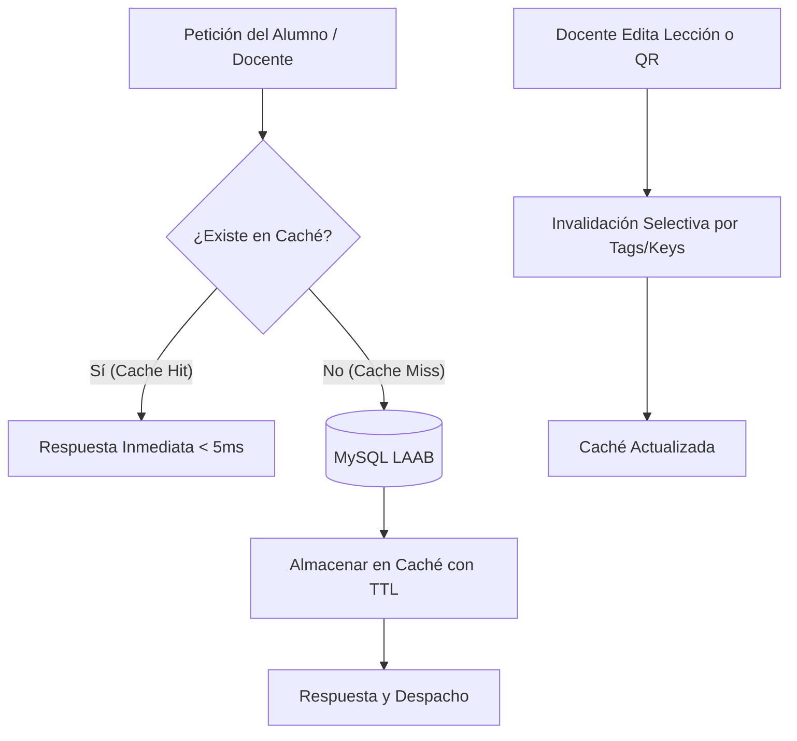

# Política de Optimización de Base de Datos y Estrategia de Caché

**Proyecto:** LAAB (Libro Aumentado de Anatomía para Biomédica)  
**Ubicación:** `docs/database_optimizations.md`  
**Motor Primario:** MySQL 8.0+ / InnoDB  
**Versión:** 1.0  
**Fecha:** Septiembre 2026  

---

## 1. Objetivos de Rendimiento

1. **Latencia de Redirección QR < 20ms:** La resolución de códigos QR `/qr/{short_code}` debe ser prácticamente instantánea desde dispositivos móviles en el aula.
2. **Carga del Índice de Estudio < 50ms:** La navegación por capítulos y lecciones del libro debe servirse desde memoria caché sin golpear la base de datos en lecturas repetidas.
3. **Cero Consultas N+1:** Prohibición estricta de carga perezosa (*lazy loading*) en listados, tablas y serializaciones JSON.
4. **Agregaciones Analíticas Eficientes:** Las estadísticas de escaneo geográfico deben calcularse utilizando índices compuestos sin bloqueos de tabla.

---

## 2. Estrategia de Indexación de Base de Datos

Cada tabla del sistema cuenta con una estrategia de índices primarios, únicos y compuestos para satisfacer las consultas críticas:

```
┌────────────────────────────────────────────────────────────────────────┐
│                        MAPA DE ÍNDICES CRÍTICOS                        │
├─────────────────────┬───────────────────────────┬──────────────────────┤
│ Tabla               │ Columnas Indexadas        │ Tipo / Caso de Uso   │
├─────────────────────┼───────────────────────────┼──────────────────────┤
│ dynamic_qrs         │ short_code, is_active     │ Compuesto (Búsqueda  │
│                     │                           │ rápida en /qr/{code})│
│ chapters            │ is_active, chapter_number │ Compuesto (Índice    │
│                     │                           │ navegable del libro) │
│ lessons             │ chapter_id, is_published  │ Compuesto (Lecciones │
│                     │                           │ visibles por alumno) │
│ h5p_contents        │ lesson_id, status         │ Compuesto (Filtro de │
│                     │                           │ actividades activas) │
│ qr_analytics        │ dynamic_qr_id, scanned_at │ Compuesto (Línea de  │
│                     │                           │ tiempo de escaneos)  │
│ qr_analytics        │ country, region           │ Compuesto (Métricas  │
│                     │                           │ geográficas)         │
│ user_scores         │ user_id, lesson_id        │ Compuesto (Progreso  │
│                     │                           │ del estudiante)      │
└─────────────────────┴───────────────────────────┴──────────────────────┘
```

### 2.1. Directrices de Tipos de Datos (InnoDB)
* **Claves Primarias y Foráneas:** Se utiliza estrictamente `char(26)` (ULID) con collation `ascii_bin` o `utf8mb4_bin` para maximizar la velocidad de comparación a nivel binario.
* **Códigos Cortos (`short_code`):** `varchar(12)` indexado como único.
* **Usernames:** `varchar(20)` indexado como único.
* **Textos Largos:** Campos como `study_guide` (`longText`) o `parameters` (`json`) **nunca** se indexan directamente; se consultan únicamente por la clave primaria del registro.

---

## 3. Estrategia de Caché por Capas

El sistema implementa dos niveles de almacenamiento en caché para equilibrar frescura y velocidad:



### 3.1. Caché de Códigos QR (`qr:{short_code}`)
* **Estrategia:** `Cache::rememberForever("qr:destination:{$shortCode}", ...)`
* **Comportamiento:**
  * Al solicitar `/qr/{short_code}`, se consulta primero la memoria caché.
  * Si existe, se obtiene la `destination_url` en menos de 2ms y se emite el HTTP 302 de inmediato.
  * El incremento del contador (`scan_count`) y el registro analítico (`qr_analytics`) se despachan de forma asíncrona o diferida para no frenar la redirección del alumno.
* **Invalidación:** En los eventos `saved` y `deleted` del modelo `DynamicQr`, se purga la clave `qr:destination:{$shortCode}`.

### 3.2. Caché del Árbol de Estudio (`study:chapters:tree`)
* **Estrategia:** `Cache::remember('study:chapters:tree', now()->addHours(6), ...)`
* **Comportamiento:** Agrupa todos los capítulos activos con sus lecciones publicadas y títulos de contenidos H5P listos para reproducción.
* **Invalidación:**
  * Al crear, editar o eliminar un `Chapter`, se borra `study:chapters:tree`.
  * Al publicar o desactivar una `Lesson` (`publish()` o `disable()`), se purga la caché.

### 3.3. Caché de Permisos y Roles (Spatie)
* Los permisos y roles se almacenan en la clave global de caché configurada por `spatie/laravel-permission` (`config('permission.cache.key')`).
* Se purga automáticamente cada vez que se asigna o revoca un permiso directo a un usuario mediante `app(PermissionRegistrar::class)->forgetCachedPermissions()`.

---

## 4. Reglas Estrictas para Consultas Eloquent

### 4.1. Prevención de Consultas N+1
Queda estrictamente prohibido iterar sobre relaciones sin carga previa (*eager loading*).

```php
// ❌ INCORRECTO: Genera 1 + N consultas a la base de datos
$chapters = Chapter::all();
foreach ($chapters as $chapter) {
    echo $chapter->lessons->count(); // N consultas
}

// ✅ CORRECTO: 2 consultas optimizadas con índices
$chapters = Chapter::active()
    ->ordered()
    ->withCount(['lessons' => fn($q) => $q->published()])
    ->get();
```

### 4.2. Proyección Selectiva de Columnas
Para listados, tablas y reportes, **nunca** se debe traer el registro completo si contiene columnas pesadas:

```php
// ✅ CORRECTO: Se evitan campos pesados como study_guide y parameters
$qrs = DynamicQr::with(['lesson:id,title,chapter_id', 'lesson.chapter:id,title'])
    ->select(['id', 'lesson_id', 'short_code', 'destination_url', 'scan_count', 'is_active', 'created_at'])
    ->latest()
    ->paginate(15);
```

### 4.3. Agregaciones Nativas en Analíticas
Las métricas analíticas deben ejecutarse directamente en el motor de base de datos utilizando agregaciones agrupadas por índice, evitando cargar miles de modelos en memoria PHP:

```php
// ✅ CORRECTO: Conteo agrupado directamente en MySQL
$byCountry = $qr->analytics()
    ->select('country', DB::raw('count(*) as total'))
    ->groupBy('country')
    ->orderByDesc('total')
    ->get();
```

---

## 5. Protocolo de Monitoreo y Mantenimiento

1. **Detección de Consultas Lentas (Slow Query Log):**
   * Configurado en MySQL para registrar cualquier consulta que supere los **100 milisegundos**.
2. **Auditoría con EXPLAIN:**
   * Cualquier consulta compleja añadida en futuras fases (como reportes de notas cruzadas xAPI) debe validarse previamente con `EXPLAIN` para verificar que use `type: const`, `ref` o `range` y nunca `type: ALL` (Full Table Scan).
3. **Mantenimiento Periódico:**
   * Ejecución mensual de `OPTIMIZE TABLE qr_analytics` y `user_scores` para desfragmentar índices y recuperar espacio en disco.
