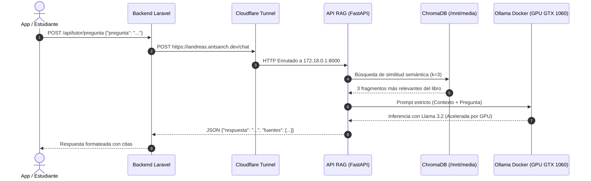

# Documentación Técnica: Tutor de Estudio en Anatomía (Sistema RAG)
### Integración para la Plataforma "Libro Aumentado" & Conexión con Laravel

**Versión:** 1.0.0  
**Fecha:** Octubre 2026  
**Ambiente:** Servidor Zorin OS 18 | GPU NVIDIA GeForce GTX 1060 (6 GB VRAM)  
**URL Base Pública:** `https://iandreas.antsanch.dev`  
**URL Base Interna (LAN / Docker):** `http://172.18.0.1:8000`

---

## 1. Resumen Ejecutivo y Arquitectura

El **Tutor de Anatomía** es un microservicio de Inteligencia Artificial basado en una arquitectura **RAG (*Retrieval-Augmented Generation*)**. Su propósito es responder consultas académicas de estudiantes de forma interactiva y con rigor científico, extrayendo respuestas únicamente del material oficial del **Manual de Anatomía IB (2da Edición)**.



---

## 2. Infraestructura y Almacenamiento

| Capa | Componente | Ubicación en el Servidor | Detalle Técnico |
| :--- | :--- | :--- | :--- |
| **Almacenamiento Masivo** | RAID 5 (`/dev/md0`) | [`/mnt/media/RAG_Anatomia`](file:///mnt/media/RAG_Anatomia) | Aloja el código fuente, entorno virtual Python (`env/`), el PDF del libro y la base de datos vectorial ChromaDB. |
| **Modelos de IA** | RAID 5 (`/mnt/media/ollama`) | [`/mnt/media/ollama/models`](file:///mnt/media/ollama/models) | Contiene los pesos pesados de los modelos (**56 GB preservados**). Compartido con Open-WebUI. |
| **Motor de Inferencia** | Ollama Docker | Contenedor `ollama:latest` | Passthrough de GPU NVIDIA activo. Ejecuta `llama3.2:latest` y `nomic-embed-text`. |
| **Servicio de Fondo** | Systemd User Service | [`~/.config/systemd/user/rag-api.service`](file:///home/antsanch/.config/systemd/user/rag-api.service) | Daemon con reinicio automático (`Restart=always`) gestionado por systemd. |
| **Exposición Web** | Cloudflare Zero Trust | Contenedor `cloudflared` | Túnel HTTPS cifrado que redirige tráfico de `iandreas.antsanch.dev` a `172.18.0.1:8000`. |

---

## 3. Especificación Técnica de la API REST

### 3.1. Endpoint Principal: Consulta al Tutor (`POST /chat`)

Envía la pregunta del alumno, recupera los fragmentos pertinentes del manual y genera una respuesta directa.

* **URL:** `https://iandreas.antsanch.dev/chat`
* **Método:** `POST`
* **Headers:**
  ```http
  Content-Type: application/json
  Accept: application/json
  ```

#### Request Payload:
```json
{
  "pregunta": "¿Qué es la fosa infratemporal y por qué estructuras está delimitada?"
}
```

#### Response Payload (`200 OK`):
```json
{
  "pregunta": "¿Qué es la fosa infratemporal y por qué estructuras está delimitada?",
  "respuesta": "La fosa infratemporal es un espacio con forma de cuña ubicado por debajo de la fosa temporal, delimitado lateralmente por la rama de la mandíbula y medialmente por la pared faríngea. Este espacio se organiza en un techo, paredes laterales, mediales y anteriores, y se comunica hacia el cuello en su parte posterior.",
  "fuentes": [
    "Fundamentos de Anatomía Humana para Ingeniería Biomédica • 203\nFosa Infratemporal\nLa fosa infratemporal es un espacio con forma de cuña ubicado por debajo de la fosa temporal, delimitado lateralment...",
    "proporcionando estabilidad.\nEjercicio. Señala los limites de la fosa infratemporal y describe su contenido...."
  ]
}
```

#### Códigos de Estado HTTP:
* **`200 OK`**: Inferencia procesada exitosamente.
* **`400 Bad Request`**: Pregunta vacía o formato de JSON inválido.
* **`500 Internal Server Error`**: Falla interna al comunicarse con Ollama o ChromaDB.

---

### 3.2. Endpoint de Salud (`GET /health`)
Utilizado para verificar la disponibilidad del microservicio (*Health Check* / *Uptime*).

* **URL:** `https://iandreas.antsanch.dev/health`
* **Método:** `GET`
* **Response (`200 OK`):**
  ```json
  {
    "status": "healthy"
  }
  ```

### 3.3. Documentación Swagger Interactiva (`GET /docs`)
Interfaz web OpenAPI autogenerada para pruebas rápidas y exploración de esquemas:
* **URL:** `https://iandreas.antsanch.dev/docs`

---

## 4. Política de Guardarraíles (Anti-Alucinaciones)

El sistema opera bajo una regla de respuesta cerrada:

1. **Hiperparámetro de Inferencia:** `temperature = 0.1` (mínima variabilidad, máxima fidelidad determinística).
2. **Restricción de Contexto:** El prompt del sistema prohíbe taxativamente usar conocimientos externos.
3. **Respuesta ante Ausencia de Datos:** Si el contenido consultado no está en el libro de texto (o es una pregunta de conocimiento general ajena a la materia), el sistema responderá textualmente:
   > *"No dispongo de esa información en el material provisto."*

---

## 5. Guía de Integración con Laravel

Para conectar tu plataforma de **Libro Aumentado** (backend en Laravel) con este servicio, implementa la siguiente estructura recomendada:

### Paso 1: Configurar variables de entorno en Laravel

Edita el archivo `.env` de tu proyecto Laravel:

```ini
# Configuración del Microservicio RAG de Anatomía
ANATOMY_RAG_BASE_URL="https://iandreas.antsanch.dev"
ANATOMY_RAG_TIMEOUT=30
```

> [!TIP]
> Si tu backend Laravel se ejecuta **en el mismo servidor físico (dentro de la misma red Docker `servidor-home`)**, puedes usar como URL: `http://172.18.0.1:8000` para reducir latencia eliminando el salto exterior por Cloudflare.

En `config/services.php` añade la sección de configuración:

```php
'anatomy_rag' => [
    'base_url' => env('ANATOMY_RAG_BASE_URL', 'https://iandreas.antsanch.dev'),
    'timeout'  => env('ANATOMY_RAG_TIMEOUT', 30),
],
```

---

### Paso 2: Crear el Servicio de Comunicación (`AnatomyTutorService.php`)

Crea la clase en `app/Services/AnatomyTutorService.php`:

```php
<?php

namespace App\Services;

use Illuminate\Support\Facades\Http;
use Illuminate\Support\Facades\Log;
use Exception;

class AnatomyTutorService
{
    protected string $baseUrl;
    protected int $timeout;

    public function __construct()
    {
        $this->baseUrl = config('services.anatomy_rag.base_url');
        $this->timeout = config('services.anatomy_rag.timeout', 30);
    }

    /**
     * Realiza una consulta al microservicio RAG de anatomía.
     *
     * @param string $pregunta
     * @return array
     * @throws Exception
     */
    public function consultar(string $pregunta): array
    {
        try {
            $response = Http::timeout($this->timeout)
                ->retry(2, 500) // Reintentar hasta 2 veces con 500ms de espera
                ->post("{$this->baseUrl}/chat", [
                    'pregunta' => trim($pregunta),
                ]);

            if ($response->successful()) {
                return $response->json();
            }

            Log::error("Error en Tutor RAG HTTP: " . $response->status(), [
                'body' => $response->body()
            ]);

            throw new Exception("El tutor de anatomía no pudo procesar la respuesta.");

        } catch (Exception $e) {
            Log::error("Excepción al conectar con el Tutor RAG: " . $e->getMessage());
            throw $e;
        }
    }

    /**
     * Comprueba la disponibilidad del servicio.
     *
     * @return bool
     */
    public function estaDisponible(): bool
    {
        try {
            $response = Http::timeout(3)->get("{$this->baseUrl}/health");
            return $response->successful();
        } catch (Exception $e) {
            return false;
        }
    }
}
```

---

### Paso 3: Crear el Controlador en Laravel (`TutorController.php`)

Crea el controlador en `app/Http/Controllers/Api/TutorController.php`:

```php
<?php

namespace App\Http\Controllers\Api;

use App\Http\Controllers\Controller;
use App\Services\AnatomyTutorService;
use Illuminate\Http\Request;
use Illuminate\Http\JsonResponse;
use Exception;

class TutorController extends Controller
{
    protected AnatomyTutorService $tutorService;

    public function __construct(AnatomyTutorService $tutorService)
    {
        $this->tutorService = $tutorService;
    }

    /**
     * Endpoint para consultar dudas al libro aumentado.
     *
     * @param Request $request
     * @return JsonResponse
     */
    public function preguntar(Request $request): JsonResponse
    {
        $validated = $request->validate([
            'pregunta' => 'required|string|min:4|max:500',
        ], [
            'pregunta.required' => 'Debes ingresar una pregunta.',
            'pregunta.min'      => 'La pregunta debe contener al menos 4 caracteres.',
            'pregunta.max'      => 'La pregunta no puede superar los 500 caracteres.',
        ]);

        try {
            $resultado = $this->tutorService->consultar($validated['pregunta']);

            return response()->json([
                'success' => true,
                'data'    => [
                    'pregunta'  => $resultado['pregunta'],
                    'respuesta' => $resultado['respuesta'],
                    'fuentes'   => $resultado['fuentes'] ?? [],
                ]
            ]);

        } catch (Exception $e) {
            return response()->json([
                'success' => false,
                'message' => 'El servicio del tutor no está disponible momentáneamente. Intenta nuevamente.',
            ], 503);
        }
    }

    /**
     * Monitoreo de estado del tutor desde Laravel.
     *
     * @return JsonResponse
     */
    public function status(): JsonResponse
    {
        $online = $this->tutorService->estaDisponible();

        return response()->json([
            'service' => 'Tutor Anatomía RAG',
            'online'  => $online,
        ], $online ? 200 : 503);
    }
}
```

---

### Paso 4: Registrar las Rutas en Laravel (`routes/api.php`)

En tu archivo `routes/api.php`:

```php
use App\Http\Controllers\Api\TutorController;

Route::prefix('v1/libro-aumentado')->group(function () {
    Route::post('/tutor/chat', [TutorController::class, 'preguntar']);
    Route::get('/tutor/status', [TutorController::class, 'status']);
});
```

---

## 6. Monitoreo y Administración Operativa (DevOps Cheat Sheet)

| Tarea Operativa | Comando en la Terminal del Servidor |
| :--- | :--- |
| **Ver estado del servicio FastAPI** | `systemctl --user status rag-api.service` |
| **Reiniciar el servicio FastAPI** | `systemctl --user restart rag-api.service` |
| **Ver logs en tiempo real** | `journalctl --user -u rag-api.service -f` |
| **Verificar uso de GPU (GTX 1060)** | `watch -n 1 nvidia-smi` |
| **Estado del contenedor Ollama** | `docker ps -f name=ollama` |
| **Logs del túnel Cloudflare** | `docker logs cloudflared --tail 50` |
| **Re-indexar si cambia el PDF** | `/mnt/media/RAG_Anatomia/env/bin/python3 /mnt/media/RAG_Anatomia/vectorizar.py` |
